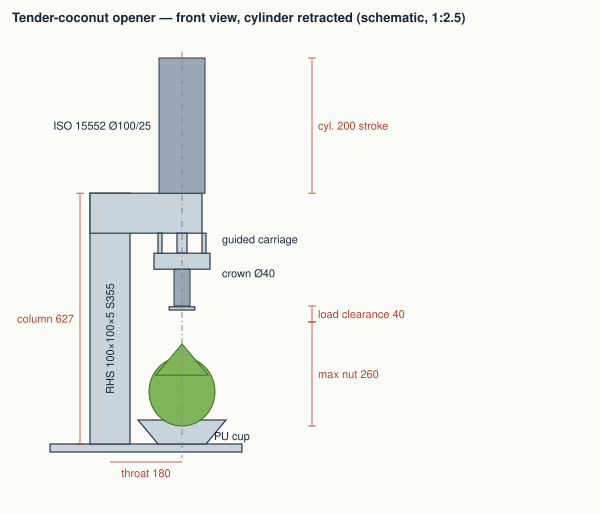

# coconut-cutter

Parametric design, safety controller and production-scale verification of a
**pneumatic tender-coconut opening machine**: a bench C-frame press that punches a
clean drinking hole in a trimmed green coconut. It is meant to be built as a line of
stations in a beverage plant.

**Full design report:** [`docs/DESIGN.md`](docs/DESIGN.md) (generated, with drawing and BOM).



## Headline numbers (2,000 nuts/h plant, 16 h/day)

| | |
|---|---|
| Station | ISO 15552 Ø100 × 200 cylinder, Ø40 serrated crown punch, RHS 100×100×5 C-frame |
| Worst-case cut load / available | 2.5 kN / 3.9 kN at 5.5 bar (≥ 1.5× margin, dull crown, envelope nut) |
| Cycle | ~0.9 s powered + operator handling ≈ 700 nuts/h per station |
| Line | **4 stations** meet 2,000/h on a bad (P05) day; +1 standby |
| Air | ≈ 1.8 m³/min FAD, ~12 kW compressor, ≥ 600 L receiver |

## How it works

```
coconut_cutter/
  coconut.py     incoming-nut population model (fit to measured intake data)
  mechanics.py   crown-punch cutting-force model + load-cell calibration
  design.py      sizing of cut depth, stroke, cylinder, rod, punch, frame, air, safety distance
  controller.py  station state machine with safety functions (ISO 13849 PL d target)
  line_sim.py    discrete-event plant simulation: operators, jams, crown wear, breakdowns, breaks
  report.py      Markdown report, BOM and SVG drawing, all generated from the model
```

`optimize()` picks the cheapest valid crown and catalogue parts (ISO 15552 cylinders and
EN 10219 RHS) that pass every engineering check. Nothing is hand-tuned.

## Verification

```bash
pip install -e ".[test]"
pytest -q                    # 45 tests, about 1 min
pytest -q -s -m prodscale    # full-year soak, about 10 M nuts
coconut-cutter report        # regenerate docs/
coconut-cutter simulate --days 300
```

What the tests prove:

- **Physics.** The analytic peak force matches a dense depth sweep (property-based).
  Calibration recovers the true material constants from noisy rig traces.
- **Design.** Every check passes. A Monte-Carlo run of 1 M nuts with a dull crown never
  exceeds the force margin, and every nut gets a clean hole without gouging the meat.
  Travel always fits inside the stroke, and the stack-up stays consistent.
  For randomly drawn assumption sets, any design that reports `ok` really serves its
  population.
- **Safety.** Thousands of fuzzed input sequences never command the punch down unless
  guard, curtain, e-stop, pressure and nut are all OK. E-stop always dumps air. Restart
  needs a reset, and the start button can't be tied down. Mutation testing confirmed the
  tests catch each of these if broken.
- **Closed loop.** 10,000 nuts run through the controller and a cylinder model (including
  a crown swap) with zero faults. An out-of-spec nut faults instead of being crushed.
- **Plant scale.** The P05 day meets the target. One station fewer does not. A production
  week and a full year meet volume with zero stalls, and the compressor keeps up with
  the line running flat out.

## Before building: replace the assumptions

The cutting resistances and the nut population are **engineering estimates**. Before release:

1. Punch at least 50 real nuts on a load-cell rig and run `mechanics.calibrate()` on the traces.
2. Measure at least 200 intake nuts and fit them with `CoconutPopulation.from_measurements()`.
3. Regenerate the report. CI fails if `docs/` drifts from the model.

Then validate the built prototype: ISO 13849-2 safety validation, a measured stopping
time for ISO 13855, a 100k-cycle endurance run and a food-safety review.
