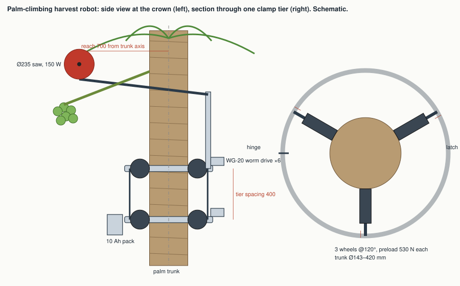

# Coconut-Palm Climbing & Harvesting Robot: Design and Plantation-Scale Verification

> Generated by `coconut-harvester report`. Every number comes from the parametric model in `coconut_harvester/`. Change an assumption, regenerate, and CI re-verifies it.

## 1. What it does

Two people carry the robot to a palm, close its two hinged clamp rings around the trunk and latch them. The robot grips with six driven wheels and climbs to the crown. The operator uses the mast camera to swing the saw arm around the trunk and cut each ripe bunch's stalk, and the bunch falls clear. The robot then drives back down and is unlatched and moved to the next palm. Nobody climbs. That removes the main hazard in coconut harvesting.

## 2. Design basis

| Parameter | Mean | SD | Min | Max |
|---|---|---|---|---|
| Climb height (m) | 12 | 4 | 4 | 22 |
| Trunk Ø at base (mm) | 310 | 35 | 230 | 420 |
| Top/base taper (–) | 0.8 | 0.07 | 0.62 | 0.98 |
| Lean (deg) | 5 | 4 | 0 | 20 |
| Leaf-scar ridge height (mm) | 5 | 2 | 1 | 10 |
| Ridge length (mm) | 50 | 12 | 30 | 90 |
| Wheel/bark friction, dry (–) | 0.7 | 0.07 | 0.5 | 0.9 |
| Bunch stalk Ø (mm) | 50 | 8 | 35 | 75 |
| Stalk distance from trunk axis (m) | 0.45 | 0.08 | 0.3 | 0.7 |

Wet bark friction = 0.6 × dry. Sizing uses the **envelope tree**: every parameter at its adverse bound at once.

## 3. Sized robot

| Item | Result |
|---|---|
| Mass | **39.3 kg** (two-person carry ≤ 40 kg) |
| Clamp tiers | 2 × 3 wheels at 120°, tier spacing 400 mm, ring opening Ø450 mm |
| Wheels | Ø150 × 50 mm PU V-tread, rated 2500 N |
| Clamp preload | 530 N per wheel, lead-screw actuator 2500 N per tier, series spring 13 N/mm, radial travel 164 mm |
| Drive | 6 × WG-20 worm gearmotor (20 Nm, 50 rpm, η 0.42, self-locking) |
| Climb / descent speed | 0.39 m/s |
| Saw | Ø235 mm TCT blade, 150 W BLDC, reach 700 mm, 360° slew |
| Battery | 24 V 10 Ah Li-ion (252 Wh), hot-swap; 3 packs per robot |
| Fall arrest | Ground belay tether, MBS 15 kN |

Mass breakdown:

| Subsystem | kg |
|---|---|
| rings (2, hinged Al 6061) | 4.80 |
| columns (3, Al tube) | 0.72 |
| wheel arms + springs | 2.70 |
| wheels | 4.20 |
| drive gearmotors | 11.40 |
| clamp actuators + load cells | 3.60 |
| harvest arm (slew ring, boom, mast) | 3.55 |
| saw unit (motor, blade, guard) | 1.83 |
| battery | 2.10 |
| electronics, camera, radio | 1.50 |
| fasteners & wiring (8 %) | 2.91 |

## 4. Engineering checks

| Check | Value | Limit | Status |
|---|---|---|---|
| Sizing converged | 1.00  | ≥ 1 | PASS |
| Climb traction, worst ridge, driest-worst bark | 1.33 x | ≥ 1.3 | PASS |
| Static hold on wet bark | 2.47 x | ≥ 1.5 | PASS |
| Min wheel load / preload (arm at full reach, max lean) | 0.63  | ≥ 0.3 | PASS |
| Peak wheel load vs wheel rating | 856.58 N | ≤ 2500 | PASS |
| Gearmotor torque vs worst-ridge demand | 1.03 x | ≥ 1 | PASS |
| Climb speed | 0.39 m/s | ≥ 0.25 | PASS |
| Worm drive self-locking (η < 0.5) | 0.42  | < 0.5 | PASS |
| Clamp actuator force | 1.84 x | ≥ 1 | PASS |
| Blade cuts thickest stalk in one pass | 82.50 mm | ≥ 75 | PASS |
| Cut time, thickest stalk | 9.42 s | ≤ 10 | PASS |
| Trees per battery charge (mean tree) | 25.99  | ≥ 20 | PASS |
| Full battery covers worst tree + reserve | 9.06 x | ≥ 1 | PASS |
| Robot mass (two-person carry) | 39.31 kg | ≤ 40 | PASS |
| Belay tether safety factor | 19.45 x | ≥ 10 | PASS |

## 5. Monte-Carlo and closed-loop results

| Metric | Value |
|---|---|
| Climb traction margin over 100,000 trees: P0.1 / median | 1.60× / 3.28× |
| Closed-loop missions (controller + physics) | 300/300 completed, no faults |
| Mission time mean / max | 81 s / 141 s (excl. carry & mount) |
| Energy per tree mean / max | 7.0 Wh / 12.1 Wh |
| Trees per pack (mean) | 29 |

## 6. Plantation scale

100 ha × 175 palms/ha = **17,500 palms**, harvested every 45 days, Mon–Sat, 7 productive h/day. Monsoon-season wet bark (Kerala-like rain calendar) grounds the robots. Ops model: trolley moves, mounting 100 s, camera aiming 30 s per bunch, battery swaps on a field charger, and breakdowns (MTBF 200 h).

**Service level:** 95 % of palms are harvested within 3 days of due and none more than 14 days late, in at least 90% of weather years. No palm is ever more than 21 days late. The fleet is the smallest that meets this over 30 simulated years. (Sizing on 10 years under-sampled monsoon variability: that fleet passed only about 65 % of fresh years.)

| Metric | Value |
|---|---|
| **Robots required** | **17** (+1 spare), 34 crew |
| Harvest visits / year | 151,249 |
| Bunches cut / year | 213,493 |
| Years meeting the round target | 27/30 |
| Lateness vs 45-day round, P95 / max (worst year) | 4 d / 9 d |
| Trees per robot per 7 productive hours | 87 |
| Robot-hours lost to wet bark / year | 10,391 |
| Battery-pack waits | 0 |
| Breakdowns / year (fleet) | 63 |
| Palms needing a manual climber | 0 |
| Fleet energy / year | 1,102 kWh |

## 7. Safety

Supervisory controller (`coconut_harvester/controller.py`), target ISO 13849-1 PL d:

- **SF1:** the clamp can never open unless the robot is on the ground.
- **SF2:** the saw runs only when all of these hold: arm deployed, robot stationary and clamped, drop zone confirmed clear, live radio link, dead-man CUT held, wind ≤ 10 m/s, no e-stop.
- **SF3:** the drive runs only when clamped at force, arm stowed, saw off, link up and tilt within limits.
- **SF4:** e-stop or link loss stops everything. The clamp keeps holding: worm drives and lead screws are self-locking, so the robot hangs safely with no power.
- **SF5:** if the IMU disagrees with wheel odometry (slip), the clamp boosts by 30 %, the robot holds and faults.
- **SF6:** no climbing on wet bark, in high wind, at the crown, or without twice the energy needed to come down. A low battery forces a descent.
- **SF7:** a stall on an out-of-envelope ridge faults. After a reset the robot can only descend.
- **SF8:** hold-to-run. Climbing and descending stop the moment the handset button is released. An automatic low-battery descent is the exception, and STOP still halts it.
- **Fall arrest:** a ground belay tether is the last line of defence.
- **Drop zone:** bunches of 5–25 kg fall from up to 22 m. The crew stays outside a radius of height/2 + 3 m and confirms it on the handset before every cut.

The test suite fuzzes the controller three ways and checks every safety function on every scan: random sensor and command streams, a plausible-plant stream with injected faults, and full harvest scripts with faults and stray commands injected at arbitrary points. Mutation testing deleted each of 10 safety rules in turn, and the tests caught every one. The fuzz also found a real flaw during development: the robot kept climbing when the operator released CLIMB. That is now SF8.

## 8. Before field release: open items

1. **Survey 50+ palms per estate** (height, diameter, taper, lean, scar ridges, bark friction with the chosen PU tread, dry and wet) and fit them with `TreePopulation.from_survey()`. Ridge geometry and wet friction drive the clamp force, so they matter most.
2. **Measure stalk cutting energy** with the chosen blade, and confirm the 80 J/cm³ assumption.
3. Prototype tests: pull-off and slip tests on real trunks, 1,000 climbs endurance, a drop test of the belay, and IP54 rain exposure.
4. Validate the safety functions on hardware (ISO 13849-2) and check the radio link range under the canopy.
5. Run a pilot block (≈ 1,000 palms for two rounds) to calibrate the mounting and aiming times in the fleet model.
