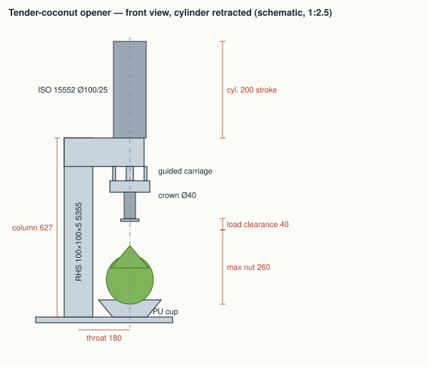

# Tender-Coconut Opening Machine — Design & Production-Scale Verification

> Generated by `coconut-cutter report`. Every number below is computed from the parametric model in `coconut_cutter/`; change an assumption, regenerate, and the test suite re-verifies it.

## 1. Concept

A bench-mounted **pneumatic crown punch**. The operator seats a trimmed tender coconut eye-end-up in a self-centering PU cup and presses start (light curtain + interlocked guard). An ISO 15552 cylinder drives a serrated tubular crown through husk and tender shell. A spring-loaded **hold-down foot** lands first and carries a **depth switch**, so the hole depth is referenced to each nut's own top — tall and short nuts get the same clean hole without adjusting anything. On the return stroke the foot strips the nut off the crown and a fixed **knockout rod** ejects the husk plug. Straw goes straight in.

## 2. Requirements

| Item | Value |
|---|---|
| Plant throughput | 2000 nuts/h, 16 h/day, 300 days/yr = **9.6 M nuts/yr** |
| Hole | Ø40 mm, ≥ 8 mm clean breakthrough on every nut |
| Air supply at machine | 5.5–7.0 bar g |
| Safety | ISO 12100 risk assessment, ISO 13849-1 PL d, ISO 13855 distances, food-contact materials (EU 1935/2004 / FDA) |

## 3. Incoming nut population (design assumption — replace with intake data)

| Parameter | Mean | SD | Min | Max |
|---|---|---|---|---|
| Diameter (mm) | 165 | 14 | 130 | 210 |
| Height (mm) | 205 | 18 | 160 | 260 |
| Husk over eye (mm) | 14 | 4 | 5 | 28 |
| Shell (mm) | 3 | 0.8 | 1.2 | 6 |
| Strength factor (×) | 1 | 0.18 | 0.6 | 1.6 |

Sizing uses the **envelope nut** (every parameter at its adverse bound simultaneously) with a crown dulled to 1.25× at the end of its swap interval.

## 4. Sized design

| Component | Result |
|---|---|
| Crown punch | Ø40 × 1.5 mm wall, engagement 0.4, length 92 mm, AISI 420 hardened |
| Cut depth (from nut top) | 42 mm |
| Cylinder | ISO 15552 Ø100/25 × 200 mm |
| Worst-case cut load (envelope nut, dull crown, + spring) | 2543 N |
| Cylinder force @ min supply | 3888 N |
| Stall force @ max supply (structural case) | 5498 N |
| Stripper spring preload | 220 N |
| Frame | RHS 100×100×5 S355, throat 180 mm, column 627 mm |
| Air per cycle | 27.7 NL |
| Light-curtain min distance (ISO 13855) | 230 mm |

## 5. Engineering checks

| Check | Value | Limit | Status |
|---|---|---|---|
| Cavity intrusion, thinnest-walled nut | 35.80 mm | ≤ 45.00 | PASS |
| Stroke reserve | 18.00 mm | ≥ 5.00 | PASS |
| Stripper spring vs strip force | 2.03 x | ≥ 2.00 | PASS |
| Cylinder force margin (min supply, dull crown, worst nut) | 1.53 x | ≥ 1.50 | PASS |
| Retract force margin | 13.23 x | ≥ 1.00 | PASS |
| Piston-rod buckling SF (stall) | 25.46 x | ≥ 3.50 | PASS |
| Punch axial stress SF (stall) | 33.00 x | ≥ 1.50 | PASS |
| Punch shell-buckling SF (stall) | 93.38 x | ≥ 1.50 | PASS |
| Punch bore holds largest plug | 77.00 mm | ≥ 34.00 | PASS |
| Frame weld stress range vs fatigue limit (EN 1993-1-9 cat 71) | 7.99 MPa | ≤ 38.76 | PASS |
| Arm width carries cylinder flange | 100.00 mm | ≥ 95.00 | PASS |
| Frame static SF (stall) | 20.56 x | ≥ 1.50 | PASS |
| Tool deflection at worst cut | 0.11 mm | ≤ 0.50 | PASS |

Fatigue: each station sees ~2.4 M cycles/yr, so the frame is designed for infinite life (stress range below the constant-amplitude fatigue limit).

## 6. Monte-Carlo over 200,000 nuts (dull crown)

| Metric | Value |
|---|---|
| Mean cut load | 1691 N |
| P99.9 cut load | 2424 N |
| Max cut load | 2520 N |
| Margin at max vs available force | 1.54× |
| Machine time mean / max | 0.89 s / 1.13 s |

## 7. Production line

Discrete-event simulation, 20 replications of a 16 h day, including operator handling (load 2.4 s, unload 1.4 s, CV 0.3), random jams (0.2 %), crown swaps every 8000 cuts, breakdowns (MTBF 120 h, MTTR 45 min) and staggered breaks.

| Metric | Value |
|---|---|
| **Stations required** | **4** (+1 standby recommended) |
| Line rate, mean | 2785 nuts/h |
| Line rate, P05 day | 2637 nuts/h (target 2000) |
| Air demand (at best-day line rate 2978/h) | 1374 NL/min |
| Compressor | ≥ 1.79 m³/min FAD @ 8 bar, ~11.6 kW |
| Air receiver | ≥ 595 L |

## 8. Bill of materials (per line)

| Item | Specification | Qty / station | Stations |
|---|---|---|---|
| C-frame column + arms | RHS 100x100x5 S355J2H, EN 10219, welded, epoxy-coated | 0.99 m | 4 |
| Base plate | S355 20 mm, 400x350, 4x M12 anchor | 1 | 4 |
| Pneumatic cylinder | ISO 15552 Ø100/25 x 200 mm, adj. cushions, magnetic piston | 1 | 4 |
| Tool guide | 2x Ø20 h6 hardened guide rods + linear bushings (anti-rotation, side-load) | 1 set | 4 |
| Crown punch | AISI 420 hardened 48-52 HRC, Ø40 x 1.5 wall x 92 mm, serrated shear-angle crown (engagement 0.4) | 1 + 2 spare | 4 |
| Hold-down / stripper foot | POM-C food-grade ring on die spring, preload 220 N | 1 | 4 |
| Knockout rod | AISI 304 Ø32, fixed to frame, through punch bore (2.5 mm radial clearance) | 1 | 4 |
| Nut cup | Food-grade PU 80 ShA conical cup, Ø130-210 self-centering, drain hole | 1 | 4 |
| Valve | 5/3 closed-centre, 24 VDC, meter-out flow controls | 1 | 4 |
| Safety dump valve | Dual-channel monitored soft-start/dump, Cat 3 | 1 | 4 |
| Sensors | Reed (home), inductive (depth switch on foot), nut-present (capacitive), pressure switch | 1 set | 4 |
| Light curtain | Type 4, 14 mm resolution, mount ≥ 230 mm | 1 pair | 4 |
| Interlocked guard | Polycarbonate + coded RFID interlock switch | 1 | 4 |
| Safety controller | Safety relay/PLC, PL d, e-stop + reset + cycle-start | 1 | 4 |
| FRL | Filter 5 µm + regulator 0-8 bar + lockable shut-off (LOTO) | 1 | 4 |

## 9. Control & safety

State machine in `coconut_cutter/controller.py` (IDLE → EXTENDING → DWELL → RETRACTING), with safety stops (guard/curtain), e-stop air dump, low-pressure fault, extend/retract timeouts (jam detection), anti-tie-down start, reset-only restart, and a crown-swap lockout. The test suite fuzzes it with random input sequences and proves the punch is never commanded down while a hand could be in the danger zone.

## 10. Before release — open items

1. **Calibrate the cutting model**: punch ≥ 50 real nuts on a load-cell rig, feed traces to `mechanics.calibrate()`, and replace the default `MaterialModel`. Regenerate this report.
2. **Measure the intake**: fit `CoconutPopulation.from_measurements()` to ≥ 200 nuts per supplier/season.
3. Validate the safety functions on the built machine (ISO 13849-2), and measure the stopping time for the ISO 13855 distance.
4. Endurance-run one prototype for 100 k cycles and inspect the frame welds and crown wear (this confirms the dulling assumption).
5. Food-safety review: wash-down (IP65 sensors), no lubricant above the cup, drained cup.
